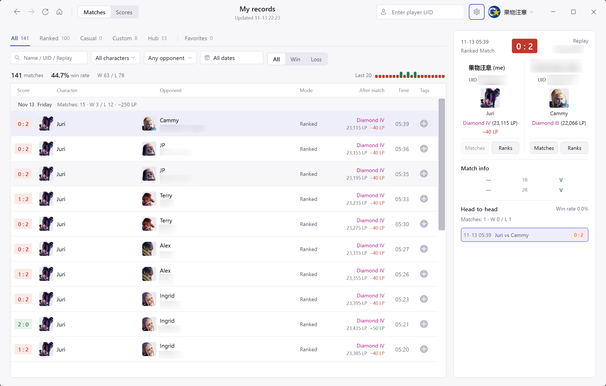
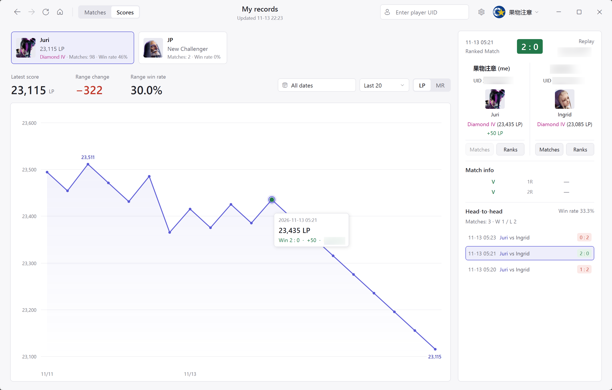

[简体中文](README.md) | [日本語](README.ja.md) | [English](README.en.md)

# SF6 Recorder

Save your `Street Fighter 6` match history from [CAPCOM's Buckler's Boot Camp](https://www.streetfighter.com/6/buckler/profile/) to your PC. The official website only keeps recent matches. Each time you refresh, `SF6 Recorder` saves new match records to a local SQLite database for long-term storage, so they remain available after they disappear from the website.

## Requirements and startup

- Windows 10 or Windows 11 (64-bit)
- The framework-dependent version requires .NET 10 Windows Desktop Runtime (x64); the self-contained version includes .NET and does not require a separate installation
- Microsoft Edge WebView2 Runtime (usually included with Windows 11)

Run `SF6 Recorder.exe`.



## Automated builds and packages

### Download automated builds

Download from the [latest release](https://github.com/MooWantFree/SF6-Recorder/releases/latest).

- `SF6-Recorder-win-x64-self-contained.zip`: includes the .NET runtime
- `SF6-Recorder-win-x64-framework-dependent.zip`: does not include the .NET runtime; requires .NET 10 Windows Desktop Runtime (x64) to be installed

### Local builds

To build and package both versions locally:

```powershell
pwsh -File .\build.ps1 -ChecksOnly
pwsh -File .\scripts\Publish-Packages.ps1
```

ZIP files are saved to `artifacts\packages` by default.

## Signing in and managing accounts

Sign in to your CAPCOM ID before downloading match history for the first time. Click "Sign in" in the upper-right corner to open the official website in the built-in browser. If a Cloudflare verification challenge appears, complete it as instructed, then enter your account credentials. Once a valid session is detected, the app saves it and closes the sign-in window automatically.

Sign-in cookies are encrypted with Windows DPAPI and stored in the local `Data` directory. Only the current Windows user can decrypt them.

The account menu in the upper-right corner lets you add multiple CAPCOM accounts, switch between them, or sign out of a specific account.

Switching accounts resets your current browsing position. Signing out removes only the sign-in credentials saved on this PC; downloaded match history and scores are kept.

## Syncing and browsing match history

The "Matches" tab at the top of the main window groups matches by date. Its category bar includes "All", "Ranked Match", "Custom Room", "Casual Match", "Battle Hub Match", and "Favorites".

Click the refresh button in the upper-left corner (`Ctrl+R`) to incrementally sync match history for the player you are currently viewing.

Combine the filters to search local records:

- The text search box (`Ctrl+F`) supports opponent names, full or partial UIDs, and replay IDs
- The dropdowns filter by your character, the opponent's character, and result (win, loss, draw, or pending)
- The date range picker supports a single day (double-click the same date in the calendar) or a range spanning multiple days

## Match details and head-to-head history

Click any match in the list to view both players' information and the match breakdown in the panel on the right:

- The top section shows the match date and time, mode, overall score, and replay ID.
- "Match info" lists both players' results for each round. Hover over an abbreviation to see its meaning.

| Round abbreviation | Meaning |
| --- | --- |
| `V` | Standard victory |
| `C` | Chip damage victory |
| `T` | Time over victory |
| `D` | Draw |
| `OD` | Overdrive finish |
| `SA` | Super Art finish |
| `CA` | Critical Art finish |
| `Perfect` | Perfect victory |
| `-` | Round lost |

## How ranked score changes are calculated

The LP and MR values returned by CAPCOM's match history API are pre-match scores. An individual replay does not contain the post-match score.

> The app follows consecutive ranked matches played with the same character. It uses the next match's pre-match score as this match's post-match score, then subtracts this match's pre-match score to calculate the change. For the latest ranked match, if the refresh successfully retrieves the character's current score from the official website, the app uses that score to estimate the post-match score and change. A tooltip explains that this difference may include matches missing from the archive. If adjacent records are missing or continuity across seasons cannot be confirmed, the app keeps the pre-match score and displays "Settlement unknown".

## Score trends



Switch to the "Scores" tab at the top to view ranked score charts by character:

- The horizontal cards at the top show characters with local records for the current player, along with their latest score, rank, and win rate. Click a card to select that character.
- On the right, choose a date range, match count (last 20, last 50, last 100, or all matches), and score type (`LP` or `MR`).
- Above the chart, a summary shows the latest score, score change, and win rate for the selected range. The chart marks the highest and lowest scores in that range automatically.
- Click any point on the chart to load the corresponding match in the details panel on the right. With the chart selected, use the left and right arrow keys to move between matches.

## Tags and favorites

The rightmost column in the match list contains tags. Click the plus button to add or remove tags for a match:

- Enter a name and press `Enter` to create a tag (1 to 32 characters), or select an existing tag.
- Any match with at least one tag appears in "Favorites". Removing its last tag removes it from Favorites, while keeping the match itself in the database.
- In "Favorites", filter matches by one or more tags and choose between "Any tag" and "All tags" matching.
- The "Player" dropdown in the upper-left corner of Favorites includes both players from every favorited match. Selecting a player makes the list and details use that player's perspective, swapping the displayed characters, scores, results, ranks, and points as needed. The saved raw replay data is unchanged.

## Looking up other players and rank history

Enter a 10-digit UID in the player search box in the upper-right corner (`Ctrl+K`) and press Enter, or click "Matches" beneath either player's portrait in the details panel on the right, to open that player's profile.

Click "Ranks" in the match details to open a separate window. View "Rank / Points" (LP and MR) or highest MR for all of that player's characters, using "All-time best" or a specific season. The "Include Unranked" toggle in the upper-right corner controls whether unranked characters are shown.

## Settings and data backup

Click the gear button in the upper-right corner (`Ctrl+,`) to open Settings.

Proxies using `http://`, `https://`, and `socks5://` without authentication are supported. Saved settings apply to subsequent sign-ins and syncs.

"CAPCOM interval" sets the minimum time between requests for official website data. The default is 2 seconds. Setting it too low may trigger CAPCOM's HTTP 429 rate limiting.

"Refresh reminder" defaults to 1 day (86400 seconds). Once the set interval has passed since the last successful refresh, the refresh icon in the upper-left corner shakes gently at regular intervals. Set it to `0` to disable the reminder.

## Keyboard shortcuts

| Shortcut | Action |
| --- | --- |
| `Ctrl+R` | Start syncing match history; press again during a download to stop it |
| `Ctrl+F` | Switch to "Matches" and focus the list's search box |
| `Ctrl+K` | Activate the player UID search box in the upper-right corner |
| `Ctrl+,` | Open Settings |
| `Alt+←` / mouse back button | Return to the previous page or player |
| `Alt+→` / mouse forward button | Go to the next page or player |
| `←` / `→` | With the chart selected in "Scores", move to the previous or next match |
| `Esc` | Close the open search box, tag popup, or calendar popup |
