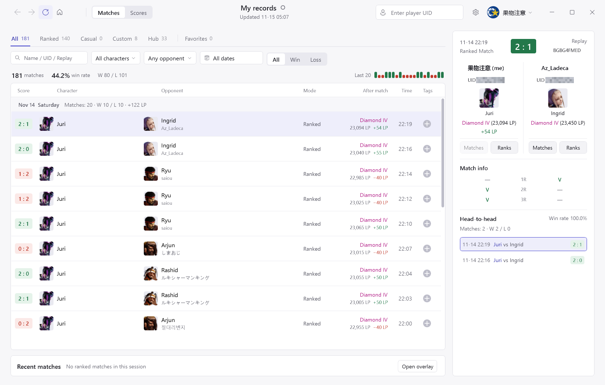
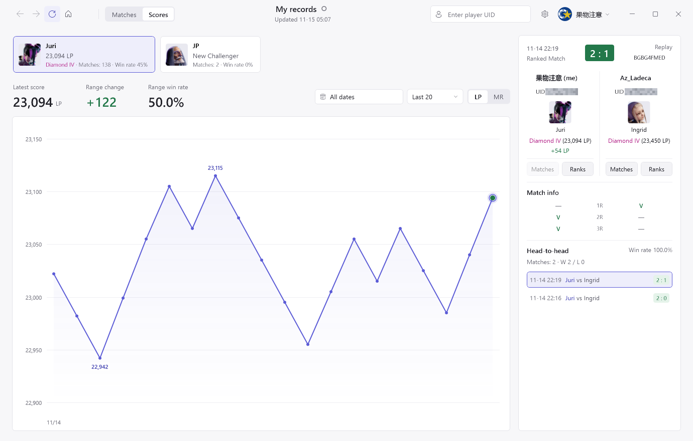
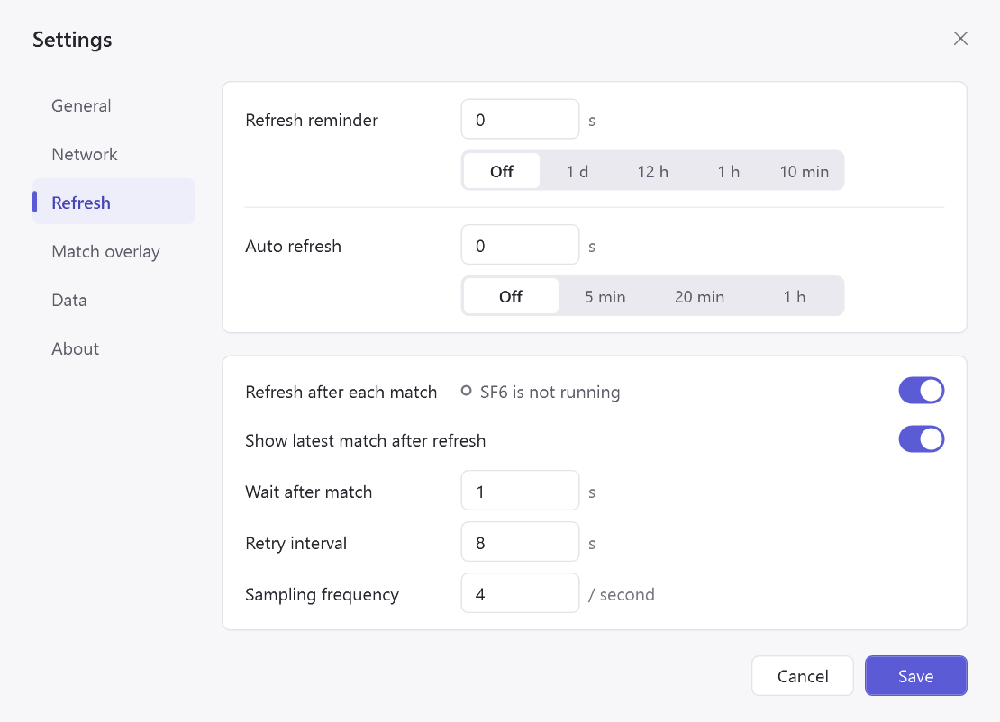
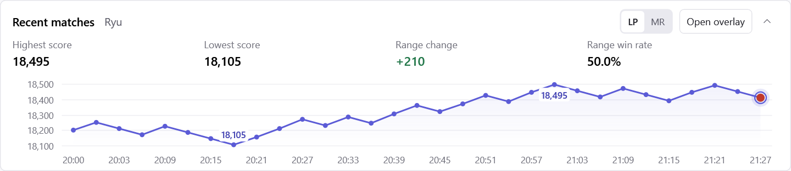
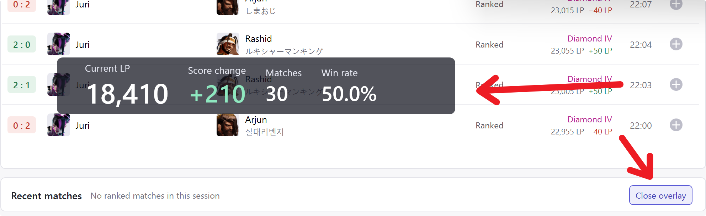
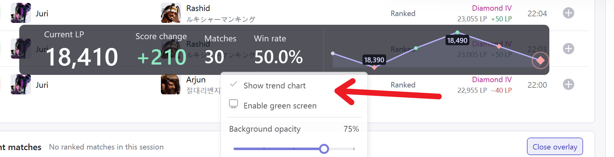
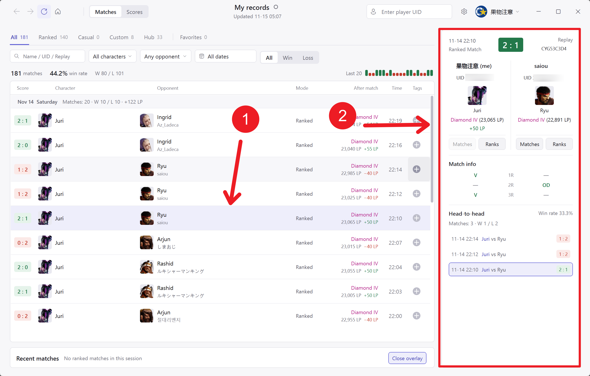
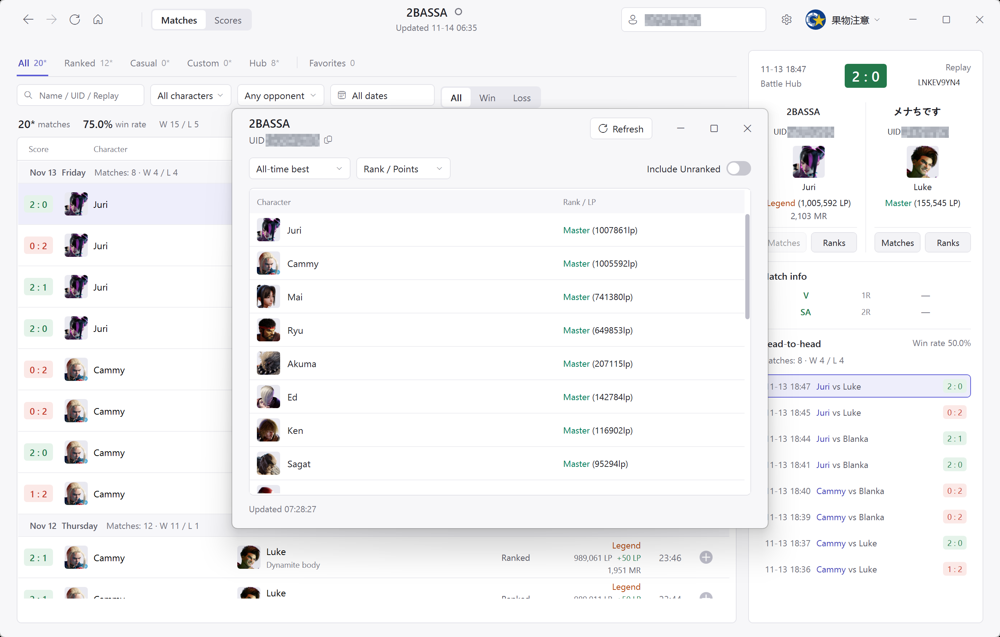

[简体中文](README.md) | [日本語](README.ja.md) | [English](README.en.md)

# SF6 Recorder

Save your `Street Fighter 6` match history from [CAPCOM's Buckler's Boot Camp](https://www.streetfighter.com/6/buckler/profile/) to your PC. The official website only keeps recent matches. Each time you refresh, `SF6 Recorder` saves new match records to a local SQLite database for long-term storage, so they remain available after they disappear from the website.

## Automated builds and packages

### Download automated builds

- [Download with the .NET runtime included](https://github.com/MooWantFree/SF6-Recorder/releases/latest/download/SF6-Recorder-win-x64-self-contained.zip)
- [Download without the runtime](https://github.com/MooWantFree/SF6-Recorder/releases/latest/download/SF6-Recorder-win-x64-framework-dependent.zip): requires .NET 10 Windows Desktop Runtime (x64)

### Local builds

```powershell
pwsh -File .\build.ps1 -ChecksOnly
pwsh -File .\scripts\Publish-Packages.ps1
```

## Requirements and startup

- Windows 10 or Windows 11 (64-bit)
- Microsoft Edge WebView2 Runtime (usually included with Windows 11)

Extract the ZIP and run `SF6 Recorder.exe`.





## Signing in and managing accounts

Sign in to your CAPCOM ID before downloading match history for the first time. Click "Sign in" in the upper-right corner to open the official website in the built-in browser. If a Cloudflare verification challenge appears, complete it as instructed, then enter your account credentials. Once a valid session is detected, the app saves it and closes the sign-in window automatically.

> Sign-in cookies are encrypted with Windows DPAPI and stored in the local `Data` directory. Only the current Windows user can decrypt them.
>
> If your connection to CAPCOM is slow, try configuring a proxy in Settings.

The account menu in the upper-right corner lets you add multiple CAPCOM accounts, switch between them, or sign out of a specific account.

Signing out removes only the sign-in credentials saved on this PC; downloaded match history and scores are kept.

## Automatic match history sync

Open **Settings → Refresh** and enable **Refresh after each match**. While SF6 is in the foreground, the app checks for the results screen at the configured sampling frequency. Once a match ends, it waits for the configured delay before refreshing. **Show latest match after refresh** selects the newest match that meets your current filters. Both settings are on by default.



> How it works: the app captures the top of the game screen and detects the results screen by looking for the English text "RESULT" or the Chinese text "结果". Only Chinese, Japanese, and English have been tested; other languages have not been tested.
>
> Measured CPU usage:
>
> | Measurement | Result (CPU: i5-12490F) |
> | --- | ---: |
> | Screen capture and recognition thread CPU usage | Approx. 0.15% |
> | Total test process CPU usage | Approx. 0.16% |
> | Average time per capture and recognition | 11.88 ms |

With **Refresh after each match** enabled, **Recent matches** appears at the bottom of **My records**.



## Match overlay and OBS capture

Click **Open overlay** on the right of **Recent matches** to open a separate window for your stream. Click the same button again to close it. By default, the overlay shows your current LP or MR, score change this session, match count, and win rate.



Right-click the overlay and select **Show trend chart** to display the score graph. In **Style settings**, you can choose which stats to show, place the chart to the right of or below them, and adjust the spacing, colors, and background opacity.



**Add the overlay to OBS**

1. Keep the overlay open. In OBS, add a **Window Capture** source and select **SF6 Recorder OBS** as the window.
2. Start with **Automatic** as the capture method. If the preview is black, open the source properties and switch the capture method to Windows Graphics Capture (WGC).
3. In **Settings → Match overlay**, click **Preview in overlay** to show sample matches. This lets you adjust the overlay’s position, size, and opacity for your OBS scene before playing a ranked match. Click **End preview** to show your own stats again.

To have the overlay ready each time you start the app, go to **Settings → Match overlay → Window** and enable **Open overlay when the app starts**.

## Match details and head-to-head history

Click a match in the list to see both players’ characters and scores, round results, and head-to-head history in the panel on the right.



To open a player’s profile, enter their 10-digit UID in the upper-right search box (`Ctrl+K`) and press Enter, or click **Matches** beneath their portrait in the details panel.

Click **Ranks** in the details panel and choose **All-time best** to see each character’s highest rank. Select a season to view **Rank / Points** or **Peak MR** for that season.



## How ranked score changes are calculated

The LP and MR values returned by CAPCOM's match history API are pre-match scores. An individual replay does not contain the post-match score.

> The app follows consecutive ranked matches played with the same character. It uses the next match's pre-match score as this match's post-match score, then subtracts this match's pre-match score to calculate the change.
>
> For the latest ranked match, if the refresh successfully retrieves the character's current score from the official website, the app uses that score to estimate the post-match score and change. A tooltip explains that this difference may include matches missing from the archive. If adjacent records are missing or continuity across seasons cannot be confirmed, the app keeps the pre-match score and displays "Settlement unknown".

## Tags and favorites

The rightmost column in the match list contains tags. Click the plus button to add or remove tags for a match:

- Enter a name and press `Enter` to create a tag (1 to 32 characters), or select an existing tag.
- Any match with at least one tag appears in "Favorites". Removing its last tag removes it from Favorites, while keeping the match itself in the database.
- In "Favorites", filter matches by one or more tags and choose between "Any tag" and "All tags" matching.
- The "Player" dropdown in the upper-left corner of Favorites includes both players from every favorited match. Selecting a player makes the list and details use that player's perspective, swapping the displayed characters, scores, results, ranks, and points as needed. The saved raw replay data is unchanged.

## Settings and data backup

Click the gear button in the upper-right corner (`Ctrl+,`), or choose "Settings" from the system tray icon's right-click menu, to open Settings.

Proxies using `http://`, `https://`, and `socks5://` without authentication are supported. Saved settings apply to subsequent sign-ins and syncs.

"CAPCOM interval" sets the minimum time between requests for official website data. The default is 2 seconds. Setting it too low may trigger CAPCOM's HTTP 429 rate limiting.

## Keyboard shortcuts

| Shortcut | Action |
| --- | --- |
| `Ctrl+R` | Start syncing match history; press again during a download to stop it |
| `Ctrl+F` | Switch to "Matches" and focus the list's search box |
| `Ctrl+K` | Activate the player UID search box in the upper-right corner |
| `Ctrl+,` | Open Settings |
| `Alt+←` / mouse back button | Return to the previous page or player |
| `Alt+→` / mouse forward button | Go to the next page or player |
| `←` / `→` | With the chart selected in "Scores", move to the previous or next match |
| `Esc` | Close the open search box, tag popup, or calendar popup |

## License

[GNU GPL v3.0](LICENSE)
