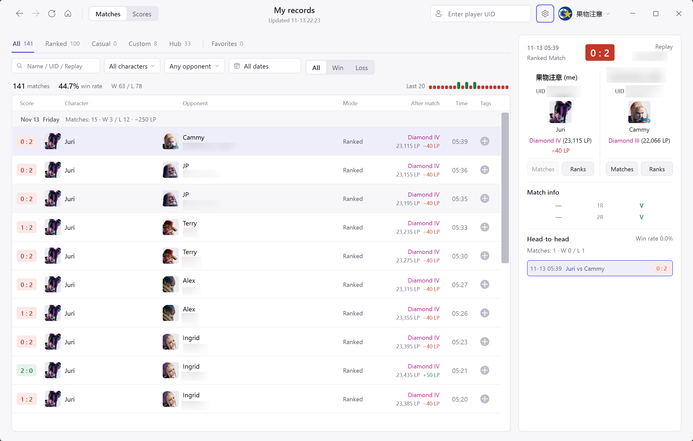
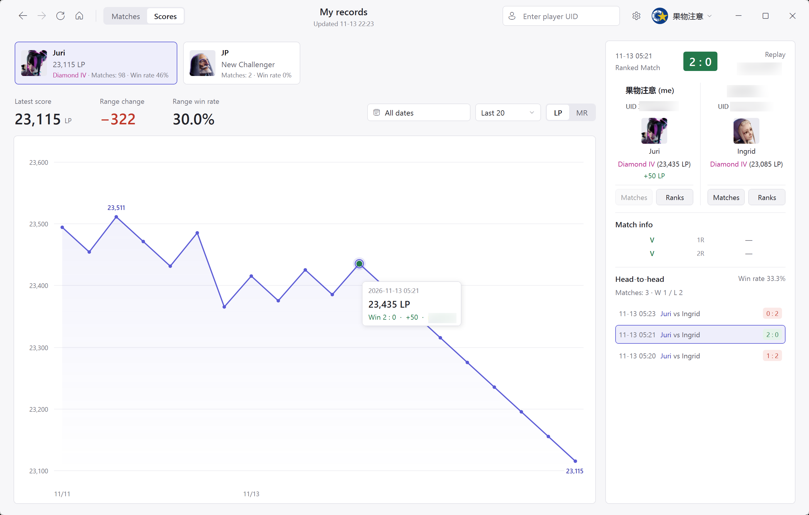

[简体中文](README.md) | [日本語](README.ja.md) | [English](README.en.md)

# SF6 Recorder

[CAPCOM の Buckler's Boot Camp](https://www.streetfighter.com/6/buckler/profile/) に掲載されている『ストリートファイター6』の対戦履歴を PC に保存するアプリです。公式サイトには直近の戦績しか残りませんが、`SF6 Recorder` は更新のたびに新しい戦績をローカルの SQLite データベースに永続保存するため、公式サイトから古い履歴が消えても、保存済みの記録は残ります。

## 動作環境と起動

- Windows 10 または Windows 11（64 ビット）
- ランタイムなし版には .NET 10 Windows Desktop Runtime（x64）が必要です。ランタイム同梱版では .NET を別途インストールする必要はありません
- Microsoft Edge WebView2 Runtime（通常、Windows 11 にはインストール済み）

`SF6 Recorder.exe` を実行してください。



## 自動ビルドと配布パッケージ

### 自動ビルドのダウンロード

[最新の Release](https://github.com/MooWantFree/SF6-Recorder/releases/latest) からダウンロードできます。

- `SF6-Recorder-win-x64-self-contained.zip`：.NET ランタイム同梱版
- `SF6-Recorder-win-x64-framework-dependent.zip`：.NET ランタイムなし版。.NET 10 Windows Desktop Runtime（x64）の事前インストールが必要です

### ローカルビルド

ローカルで両方の版をビルドして ZIP を生成するには、次のコマンドを実行します。

```powershell
pwsh -File .\build.ps1 -ChecksOnly
pwsh -File .\scripts\Publish-Packages.ps1
```

ZIP の既定の保存先は `artifacts\packages` です。

## ログインとアカウント管理

初めて戦績を取得する前に、CAPCOM ID でログインしてください。右上の「ログイン」ボタンを押すと、内蔵ブラウザーで公式サイトが開きます。Cloudflare の認証画面が表示された場合は、案内に従って認証を完了し、アカウント情報を入力してログインしてください。有効なセッションが検出されると、自動で保存され、ログインウィンドウが閉じます。

ログイン Cookie は Windows DPAPI で暗号化され、ローカルの `Data` ディレクトリに保存されます。復号できるのは、現在の Windows ユーザーだけです。

右上のアカウントメニューから、複数の CAPCOM アカウントの追加、切り替え、特定のアカウントからのログアウトができます。

アカウントを切り替えると、現在の閲覧位置はリセットされます。ログアウトで削除されるのは、この PC に保存されたログイン情報だけで、ダウンロード済みの戦績やスコアは残ります。

## 戦績の同期と閲覧

メインウィンドウ上部の「戦績」タブには、対戦が日付ごとに表示されます。カテゴリーは「すべて」「ランクマッチ」「カスタムルーム」「カジュアルマッチ」「バトルハブ対戦」「お気に入り」です。

左上の更新ボタン（`Ctrl+R`）を押すと、現在表示しているプレイヤーの戦績を差分同期します。

フィルターを組み合わせて、ローカルの記録を絞り込めます。

- テキスト検索欄（`Ctrl+F`）では、対戦相手の名前、UID の全体または一部、リプレイ ID で検索できます
- ドロップダウンでは、自分のキャラクター、相手のキャラクター、対戦結果（勝ち、負け、引き分け、未確定）を指定できます
- 日付選択では、単日（カレンダーで同じ日付をダブルクリック）または複数日にまたがる期間を指定できます

## 対戦詳細と過去の対戦履歴

一覧から対戦を選ぶと、右側のパネルに両プレイヤーの情報と対戦の内訳が表示されます。

- 上部には対戦日時、対戦モード、最終スコア、リプレイ ID が表示されます。
- 「対戦情報」には、ラウンドごとの両プレイヤーの結果が表示されます。略称にマウスを合わせると説明を確認できます。

| ラウンドの略称 | 意味 |
| --- | --- |
| `V` | 通常勝利 |
| `C` | 削り勝利 |
| `T` | タイムオーバー勝利 |
| `D` | 引き分け |
| `OD` | OD フィニッシュ |
| `SA` | SA フィニッシュ |
| `CA` | CA フィニッシュ |
| `Perfect` | パーフェクト勝利 |
| `-` | このラウンドで敗北 |

## ランクマッチのスコア変動の算出方法

CAPCOM 公式の戦績 API に記録されている LP と MR は、いずれも対戦開始前の値です。リプレイ単体には、対戦後の確定値は含まれていません。

> アプリは同じキャラクターで行った連続するランクマッチを参照します。次の対戦の開始前スコアを今回の対戦後スコアとし、今回の開始前スコアとの差から増減を算出します。最新のランクマッチについては、更新時に公式サイトから現在のキャラクタースコアを取得できた場合、その値を使って対戦後スコアと増減を推定します。この差には未収録の対戦が含まれる可能性があることを、ツールチップで案内します。隣接する記録がない場合や、シーズンをまたいで連続性を確認できない場合は、開始前のスコアを維持し、「対戦後の変動は不明」と表示します。

## スコア推移



上部の「スコア」タブに切り替えると、キャラクターごとのランクマッチのスコア推移を確認できます。

- 上部に横並びで表示されるカードには、現在のプレイヤーについてローカルに記録があるキャラクターと、その最新スコア、ランク、勝率が表示されます。カードをクリックするとキャラクターを切り替えられます。
- 右側で期間、対戦数（直近 20 戦、50 戦、100 戦、すべて）、スコアの種類（`LP` または `MR`）を選択できます。
- グラフの上には、選択した範囲の最新スコア、スコアの増減、勝率が表示されます。グラフ内には、その範囲の最高値と最低値が自動で示されます。
- グラフ上の点をクリックすると、対応する対戦が右側の詳細パネルに表示されます。グラフを選択した状態では、左右の矢印キーで対戦を順に切り替えることもできます。

## タグとお気に入り

戦績一覧の一番右はタグ欄です。プラスボタンを押すと、その対戦にタグを追加したり、タグを外したりできます。

- 名前を入力して `Enter` を押すと、新しいタグを作成できます（1～32 文字）。既存のタグを選択することもできます。
- タグが 1 つでも付いた対戦は「お気に入り」に表示されます。最後のタグを外すとお気に入りから消えますが、対戦の記録自体はデータベースに残ります。
- 「お気に入り」では、1 つ以上のタグで対戦を絞り込み、「いずれかのタグ」と「すべてのタグ」の条件を切り替えられます。
- お気に入りの左上にある「プレイヤー」ドロップダウンには、お気に入りに登録した対戦の両プレイヤーが含まれます。選択を切り替えると、そのプレイヤーを自分側として一覧と詳細を表示し、両者のキャラクター、スコア、勝敗、ランク、ポイントの表示を入れ替えます。保存済みの元のリプレイデータは変更されません。

## 他のプレイヤーとランク履歴の検索

右上のプレイヤー検索欄（`Ctrl+K`）に 10 桁の UID を入力して Enter を押すか、右側の対戦詳細パネルでどちらかのプレイヤーの画像の下にある「戦績を見る」をクリックすると、そのプレイヤーのプロフィールに切り替わります。

対戦詳細の「ランク履歴」をクリックすると、別のウィンドウが開きます。「最高到達」または指定したシーズンについて、そのプレイヤーの全キャラクターの「ランク / ポイント」（LP と MR）や「最高 MR」を確認できます。右上の「Unranked を含む」で、未認定のキャラクターを表示するかどうかを切り替えられます。

## 設定とデータのバックアップ

右上の歯車ボタン（`Ctrl+,`）を押すと、設定ウィンドウが開きます。

認証なしの `http://`、`https://`、`socks5://` プロキシに対応しています。保存した設定は、次回以降のログインと同期に適用されます。

「CAPCOM リクエスト間隔」は、公式サイトのデータ取得リクエスト間の最短待機時間です。既定値は 2 秒で、短すぎると CAPCOM 側のレート制限（HTTP 429）にかかる可能性があります。

「更新リマインダー」の既定値は 1 日（86400 秒）です。最後に正常に更新してから指定した秒数が経過すると、左上の更新アイコンが定期的に小さく揺れます。`0` に設定すると、リマインダーを無効にできます。

## キーボードショートカット

| ショートカット | 操作 |
| --- | --- |
| `Ctrl+R` | 戦績の同期を開始。ダウンロード中にもう一度押すと停止 |
| `Ctrl+F` | 「戦績」タブに切り替え、一覧の検索欄にフォーカス |
| `Ctrl+K` | 右上のプレイヤー UID 検索欄を有効にする |
| `Ctrl+,` | 設定を開く |
| `Alt+←` / マウスの戻るボタン | 前に表示していたページやプレイヤーに戻る |
| `Alt+→` / マウスの進むボタン | 次のページやプレイヤーに進む |
| `←` / `→` | 「スコア」でグラフを選択した状態で、前または次の対戦に切り替える |
| `Esc` | 開いている検索欄、タグのポップアップ、カレンダーのポップアップを閉じる |
