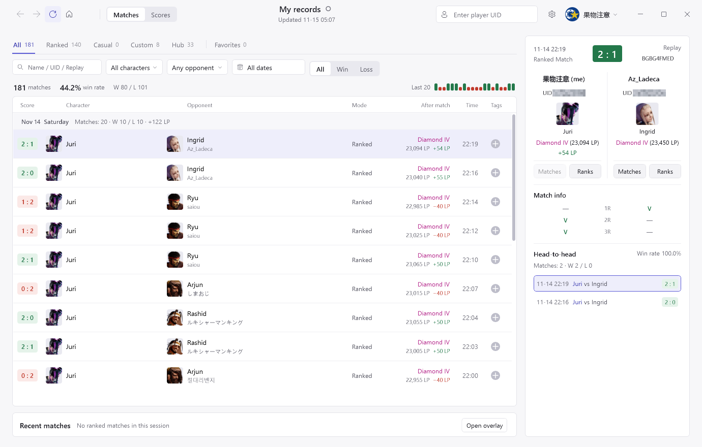
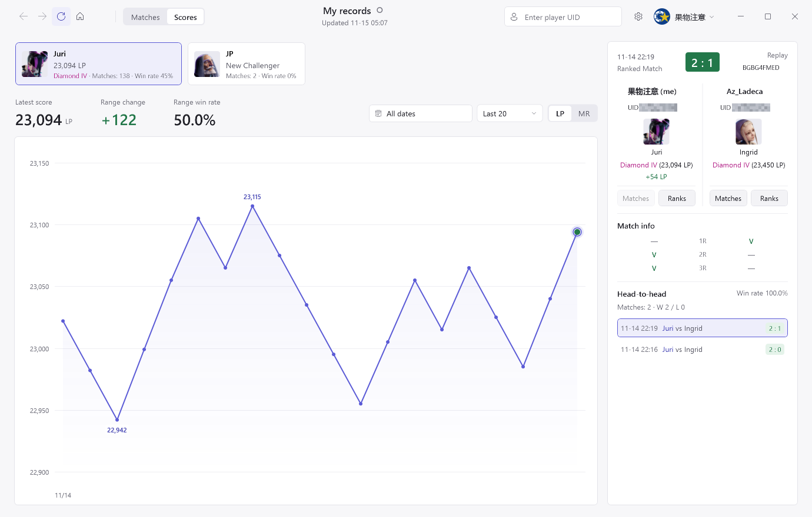
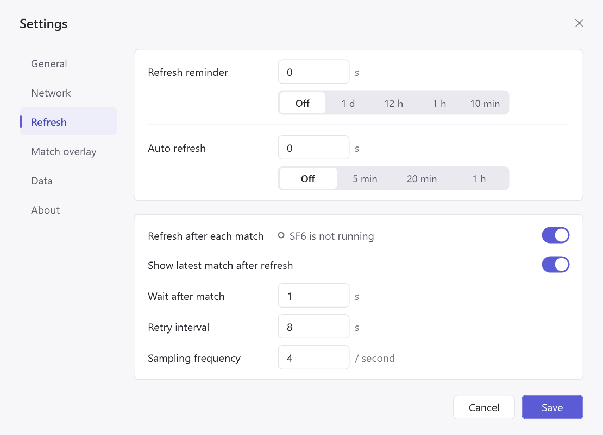
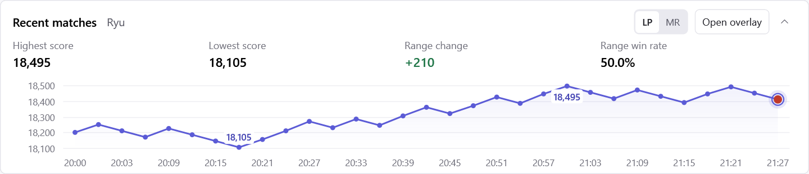
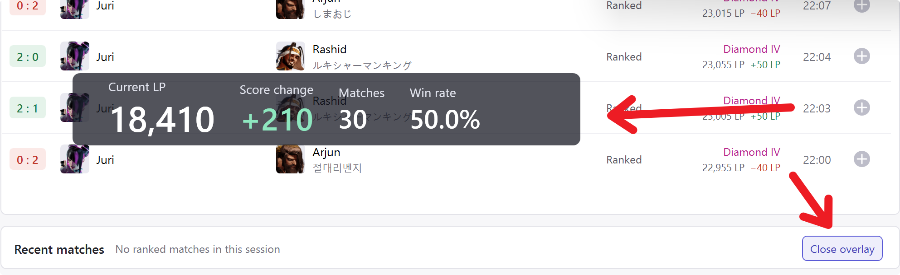
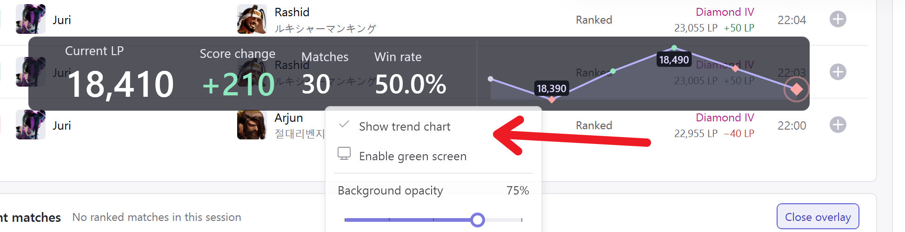
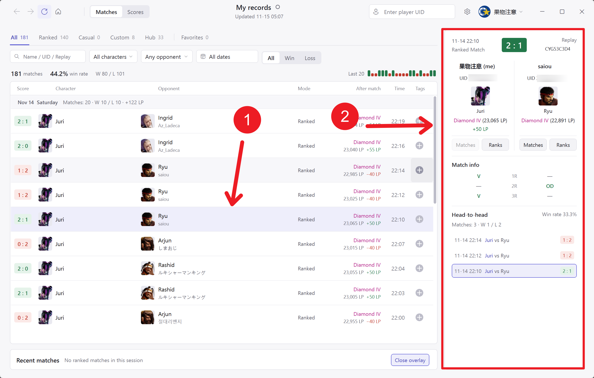
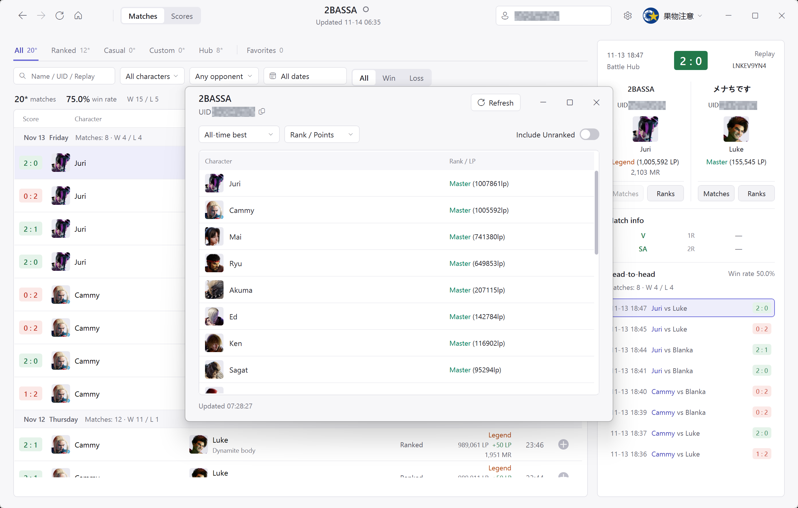

[简体中文](README.md) | [日本語](README.ja.md) | [English](README.en.md)

# SF6 Recorder

[CAPCOM の Buckler's Boot Camp](https://www.streetfighter.com/6/buckler/profile/) に掲載されている『ストリートファイター6』の対戦履歴を PC に保存するアプリです。公式サイトには直近の戦績しか残りませんが、`SF6 Recorder` は更新のたびに新しい戦績をローカルの SQLite データベースに永続保存するため、公式サイトから古い履歴が消えても、保存済みの記録は残ります。

## 自動ビルドと配布パッケージ

### 自動ビルドのダウンロード

- [.NET ランタイム同梱版をダウンロード](https://github.com/MooWantFree/SF6-Recorder/releases/latest/download/SF6-Recorder-win-x64-self-contained.zip)
- [ランタイムなし版をダウンロード](https://github.com/MooWantFree/SF6-Recorder/releases/latest/download/SF6-Recorder-win-x64-framework-dependent.zip)：.NET 10 Windows Desktop Runtime（x64）の事前インストールが必要です。

### ローカルビルド

```powershell
pwsh -File .\build.ps1 -ChecksOnly
pwsh -File .\scripts\Publish-Packages.ps1
```

## 動作環境と起動

- Windows 10 または Windows 11（64 ビット）
- Microsoft Edge WebView2 Runtime（通常、Windows 11 にはインストール済み）

ZIP を展開し、`SF6 Recorder.exe` を実行してください。





## ログインとアカウント管理

初めて戦績を取得する前に、CAPCOM ID でログインしてください。右上の「ログイン」ボタンを押すと、内蔵ブラウザーで公式サイトが開きます。Cloudflare の認証画面が表示された場合は、案内に従って認証を完了し、アカウント情報を入力してログインしてください。有効なセッションが検出されると、自動で保存され、ログインウィンドウが閉じます。

> ログイン Cookie は Windows DPAPI で暗号化され、ローカルの `Data` ディレクトリに保存されます。復号できるのは、現在の Windows ユーザーだけです。
>
> CAPCOM への接続が遅い場合は、設定でプロキシを指定してみてください。

右上のアカウントメニューから、複数の CAPCOM アカウントの追加、切り替え、特定のアカウントからのログアウトができます。

ログアウトで削除されるのは、この PC に保存されたログイン情報だけで、ダウンロード済みの戦績やスコアは残ります。

## 戦績の自動更新

「設定 → 更新」で「対戦終了後に更新」（Refresh after each match）を有効にします。SF6 が前面にある間、アプリは設定した頻度でリザルト画面を検出し、対戦終了から指定した秒数が経つと戦績を更新します。「更新後に最新の対戦を選択」（Show latest match after refresh）を有効にすると、現在の絞り込み条件に合う最新の対戦が自動で選ばれます。どちらも初期設定で有効です。



> 仕組み：ゲーム画面の上部をキャプチャし、英語の「RESULT」または中国語の「结果」を検出してリザルト画面の表示を判定します。動作確認済みの言語は中国語・日本語・英語のみで、その他の言語は未確認です。
>
> CPU 使用率の実測値：
>
> | 計測項目 | 結果（CPU：i5-12490F） |
> | --- | ---: |
> | 画面キャプチャ・文字認識スレッドの CPU 使用率 | 約 0.15% |
> | テストプロセス全体の CPU 使用率 | 約 0.16% |
> | キャプチャ・文字認識 1 回あたりの平均処理時間 | 11.88 ミリ秒 |

「対戦終了後に更新」を有効にすると、「自分の戦績」ページの下部に「最近の対戦」が表示されます。



## 戦績オーバーレイを OBS に取り込む

「最近の対戦」（Recent matches）の右端にある「戦績ウィンドウを開く」（Open overlay）をクリックすると、配信に使える独立したウィンドウが開きます。同じボタンをもう一度クリックすると閉じます。初期設定では、現在の LP または MR、今回の起動以降のスコア増減、対戦数、勝率が表示されます。



オーバーレイを右クリックして「推移グラフを表示」（Show trend chart）にチェックを入れると、スコアの推移も表示できます。「スタイル設定」（Style settings）では、表示する指標やグラフの位置（右または下）を選び、間隔、色、背景の不透明度を調整できます。



**OBS に追加する手順**

1. オーバーレイを開いたまま、OBS の「ソース」に「ウィンドウキャプチャ」を追加し、対象のウィンドウに「SF6 Recorder OBS」を選びます。
2. キャプチャ方法はまず「自動」を選びます。プレビューが真っ黒な場合は、ソースのプロパティを開き、キャプチャ方法を Windows Graphics Capture（WGC）に切り替えます。
3. 「設定 → 戦績オーバーレイ」で「オーバーレイでプレビュー」（Preview in overlay）をクリックすると、ランクマッチを始める前でもサンプル戦績が表示されます。OBS で見え方を確認しながら位置、サイズ、不透明度を調整できます。「プレビューを終了」（End preview）をクリックすると、自分の戦績に戻ります。

毎回の起動時にオーバーレイを開くには、「設定 → 戦績オーバーレイ」の「ウィンドウ」タブで「起動時に戦績オーバーレイを開く」を有効にします。

## 対戦詳細と過去の対戦履歴

一覧から対戦を選ぶと、右側のパネルに双方のキャラクターとスコア、各ラウンドの結果、過去の対戦成績が表示されます。



右上のプレイヤー検索欄（`Ctrl+K`）に 10 桁の UID を入力して Enter を押すか、対戦詳細でプレイヤーの画像の下にある「戦績を見る」をクリックすると、そのプレイヤーのプロフィールに切り替わります。

対戦詳細の「ランク履歴」（Ranks）で「最高到達」（All-time best）を選ぶと、各キャラクターの歴代最高ランクを確認できます。シーズンを指定すると、そのシーズンの「ランク / ポイント」（Rank / Points）や「最高 MR」（Peak MR）を表示できます。



## ランクマッチのスコア変動の算出方法

CAPCOM 公式の戦績 API に記録されている LP と MR は、いずれも対戦開始前の値です。リプレイ単体には、対戦後の確定値は含まれていません。

> アプリは同じキャラクターで行った連続するランクマッチを参照します。次の対戦の開始前スコアを今回の対戦後スコアとし、今回の開始前スコアとの差から増減を算出します。
>
> 最新のランクマッチについては、更新時に公式サイトから現在のキャラクタースコアを取得できた場合、その値を使って対戦後スコアと増減を推定します。この差には未収録の対戦が含まれる可能性があることを、ツールチップで案内します。隣接する記録がない場合や、シーズンをまたいで連続性を確認できない場合は、開始前のスコアを維持し、「対戦後の変動は不明」と表示します。

## タグとお気に入り

戦績一覧の一番右はタグ欄です。プラスボタンを押すと、その対戦にタグを追加したり、タグを外したりできます。

- 名前を入力して `Enter` を押すと、新しいタグを作成できます（1～32 文字）。既存のタグを選択することもできます。
- タグが 1 つでも付いた対戦は「お気に入り」に表示されます。最後のタグを外すとお気に入りから消えますが、対戦の記録自体はデータベースに残ります。
- 「お気に入り」では、1 つ以上のタグで対戦を絞り込み、「いずれかのタグ」と「すべてのタグ」の条件を切り替えられます。
- お気に入りの左上にある「プレイヤー」ドロップダウンには、お気に入りに登録した対戦の両プレイヤーが含まれます。選択を切り替えると、そのプレイヤーを自分側として一覧と詳細を表示し、両者のキャラクター、スコア、勝敗、ランク、ポイントの表示を入れ替えます。保存済みの元のリプレイデータは変更されません。

## 設定とデータのバックアップ

右上の歯車ボタン（`Ctrl+,`）を押すか、タスクトレイアイコンの右クリックメニューから「設定」を選ぶと、設定ウィンドウが開きます。

認証なしの `http://`、`https://`、`socks5://` プロキシに対応しています。保存した設定は、次回以降のログインと同期に適用されます。

「CAPCOM リクエスト間隔」は、公式サイトのデータ取得リクエスト間の最短待機時間です。既定値は 2 秒で、短すぎると CAPCOM 側のレート制限（HTTP 429）にかかる可能性があります。

## キーボードショートカット

| ショートカット | 操作 |
| --- | --- |
| `Ctrl+R` | 戦績の同期を開始。ダウンロード中にもう一度押すと停止 |
| `Ctrl+F` | 「戦績」タブに切り替え、一覧の検索欄にフォーカス |
| `Ctrl+K` | 右上のプレイヤー UID 検索欄を有効にする |
| `Ctrl+,` | 設定を開く |
| `Alt+←` / マウスの戻るボタン | 前に表示していたページやプレイヤーに戻る |
| `Alt+→` / マウスの進むボタン | 次のページやプレイヤーに進む |
| `←` / `→` | 「スコア」でグラフを選択した状態で、前または次の対戦に切り替える |
| `Esc` | 開いている検索欄、タグのポップアップ、カレンダーのポップアップを閉じる |

## License

[GNU GPL v3.0](LICENSE)
