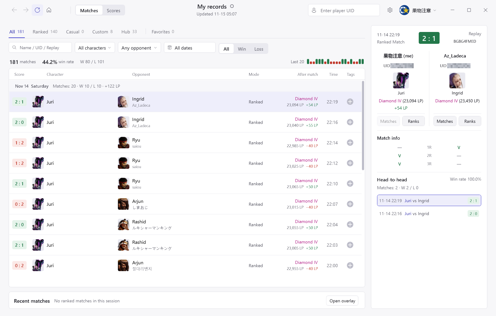
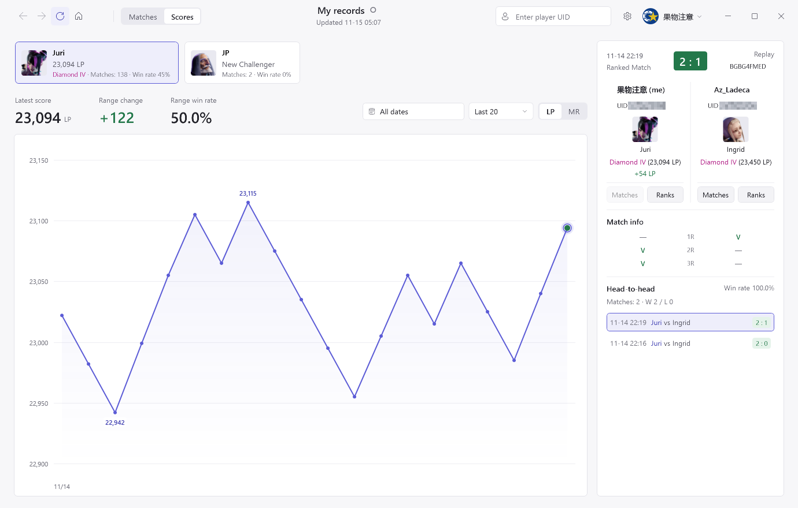
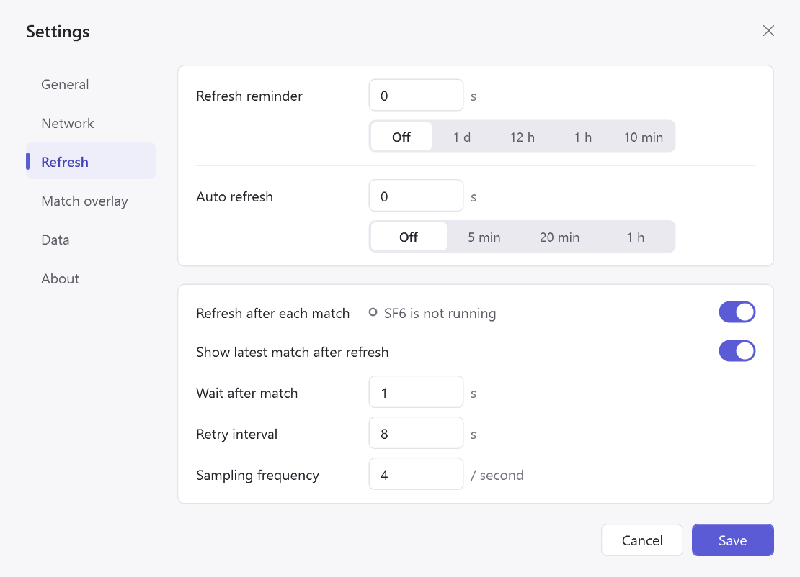
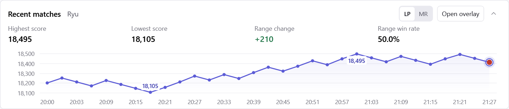
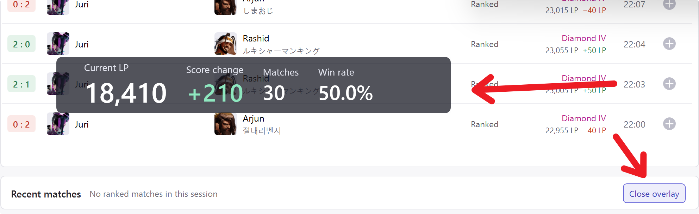
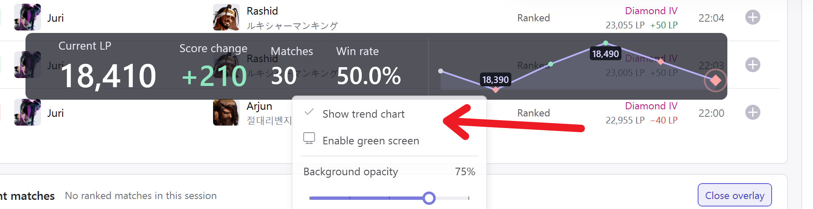
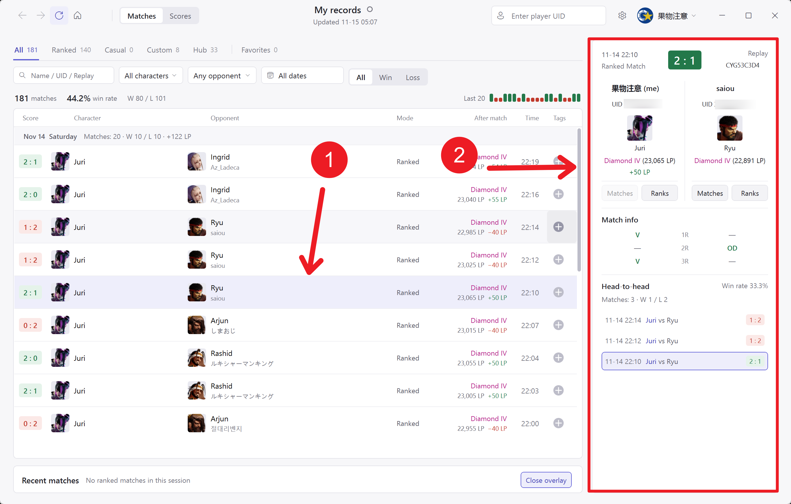
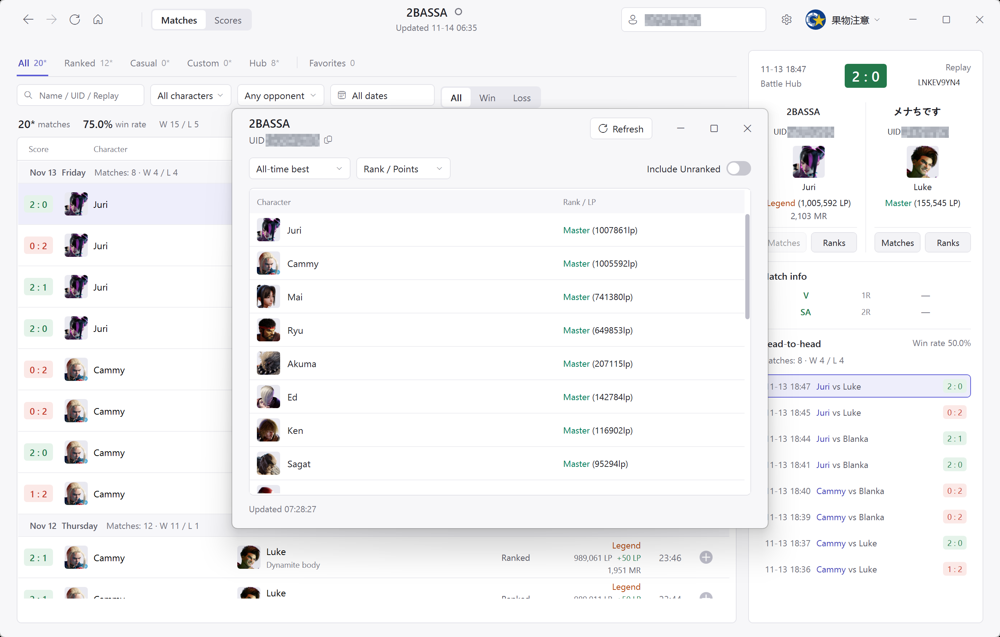

[简体中文](README.md) | [日本語](README.ja.md) | [English](README.en.md)

# SF6 Recorder
https://github.com/user-attachments/assets/7ce6a944-e4d6-458a-bda5-87e9c972eace

用于将 [CAPCOM Buckler's Boot Camp](https://www.streetfighter.com/6/buckler/profile/) 上的`Street Fighter 6`对局记录保存到本机. 官网只保留最近一段时间的战绩, `SF6 Recorder`每次刷新会把新增战绩记录写入本地 SQLite 数据库持久保存, 不随官网历史滚动而消失.

## 自动构建与发布包

### 自动构建

- [完整版 (自带 .NET 运行时)](https://github.com/MooWantFree/SF6-Recorder/releases/latest/download/SF6-Recorder-win-x64-self-contained.zip)
- [精简版](https://github.com/MooWantFree/SF6-Recorder/releases/latest/download/SF6-Recorder-win-x64-framework-dependent.zip): 需要安装 .NET 10 Windows Desktop Runtime (x64)

### 本地构建

```powershell
pwsh -File .\build.ps1 -ChecksOnly
pwsh -File .\scripts\Publish-Packages.ps1
```

## 运行环境与启动

- Windows 10/11 (64 位)
- Microsoft Edge WebView2 Runtime (Windows 11 通常已自带)

解压后直接运行 `SF6 Recorder.exe`





## 登录与账号管理

首次获取战绩前需要先登录 CAPCOM ID. 点击右上角的 `登录` 按钮会打开内置浏览器窗口并加载官网. 如果在页面上遇到 Cloudflare 人机验证, 按页面提示完成验证, 再输入账号密码登录. 检测到有效会话后会自动保存并关闭登录窗口.

> 登录 Cookie 使用 Windows DPAPI 加密保存在本地 `Data` 目录中, 仅当前 Windows 系统用户可解密.
>
> 若你的网络访问capcom很慢, 可以尝试在设置中添加代理.

右上角的账号菜单支持添加多个 CAPCOM 账号, 在不同账号之间切换, 或登出指定账号.

登出账号只清除这台电脑上保存的登录凭据, 已下载到本地的战绩和分数会继续保留.

## 自动同步战绩

在 "设置 → 刷新" 开启 "对局结束后刷新" (Refresh after each match, 默认开启). 游戏在前台时, 程序会按设定频率检测结算画面, 并在对局结束后按设定的延迟刷新战绩. 开启 "刷新后定位最新对局"(Show latest match after refresh, 默认开启), 列表会自动选中当前筛选条件下的最新对局.



> 实现原理: 截取游戏顶部截图, 出现结算画面时认为是对局结束, 判定方式为判断是否出现英文"RESULT"或者中文"结果", 目前只测试了中日英三语, 其他语言未测试.
>
> 实测CPU占用:
>
> | 测试项目                | 结果(CPU: i5-12490F) |
> | ----------------------- | -------------------: |
> | 截图＋识别线程 CPU 占用 |             约 0.15% |
> | 测试进程整体 CPU 占用   |             约 0.16% |
> | 单次截图＋识别平均耗时  |           11.88 毫秒 |

开启 "对局结束后刷新" 后, 我的战绩页底部会显示 "最近比赛".



## 战绩浮窗与 OBS 采集

在 "最近比赛" (Recent matches) 右侧点击 "打开战绩浮窗" (Open overlay), 即可把战绩单独放进直播画面; 再次点击同一位置可关闭. 浮窗默认显示当前 LP 或 MR, 本次加减分, 对局数和胜率.



右键浮窗, 勾选 "显示走势图" (Show trend chart) 即可展开曲线. 在 "样式设置" (Style settings) 里可以选择显示哪些指标, 把走势图放在右侧或下方, 并调整间距, 颜色和背景不透明度.



**添加到 OBS**

1. 保持浮窗开启, 在 OBS 的 "来源" 中添加 "窗口采集", 选择 "SF6 Recorder OBS".
2. 采集方式可先使用 "自动". 若预览黑屏, 打开该来源的属性, 将采集方式改为 "新版 (WGC)".
3. 在 "设置 → 战绩浮窗" 点击 "在浮窗中预览" (Preview in overlay), 即使还没打排位, 也能用示例数据在 OBS 中调整位置, 大小和透明度. 调好后点击 "结束预览" (End preview), 即可恢复显示自己的战绩.

如果希望每次直播都能直接采集, 在 "设置 → 战绩浮窗" 的 "窗口" 页开启 "启动软件时打开战绩浮窗".

## 对局详情与历史交手

点击列表中的任意一场对局, 右侧面板会展示双方角色, 分数, 各回合结果和历史交手.



在右上角玩家搜索框 (`Ctrl+K`) 输入 10 位 UID 后回车, 或在右侧对局详情面板中点击头像下方 "查看战绩", 可切换到该玩家的档案.

点击对局详情中的 "历史段位" (Ranks), 可查看各角色的生涯最高段位 (All-time best), 也可选择赛季查看当季段位与积分 (Rank / Points) 或最高 MR (Peak MR).



## 排位分数结算说明

CAPCOM 官网战绩接口记录的 LP 和 MR 均为开赛前的分数, 单条回放本身不包含赛后结算值.

> 程序按同一角色在排位赛中的连续对局顺序, 用 "下一场排位赛的赛前分数减去本场赛前分数" 得出本场的赛后分数与单局增减.
>
> 对于最新一场排位赛, 如果刷新时成功读取了官网的当前角色分数, 程序会用当前分数减去本场赛前分数来推算结算, 并在悬浮提示中说明该差值可能包含未收录的对局; 如果缺少相邻记录或跨赛季无法确认连续性, 则会保留赛前分数并提示 "本场结算未知".

## 标签与收藏

战绩列表最右侧为标签列. 点击加号按钮, 即可为这场对局添加或移除标签:

- 输入名称后按 `Enter` 可创建新标签 (长度为 1 到 32 个字符), 也可以直接勾选已有标签.
- 只要一场对局带有任意标签, 它就会出现在 "收藏" 分类中; 移除最后一个标签后, 该局会自动退出收藏, 但战绩本身不会从数据库删除.
- 在 "收藏" 分类下, 可以按一个或多个标签筛选对局, 并在 "任一标签" 与 "同时包含" 两种匹配方式之间切换.
- 收藏分类左上角的 "用户" 下拉框包含所有已收藏对局的双方玩家. 切换所选用户后, 列表和详情会把该用户放到己方视角, 自动对调双方的角色, 比分, 胜负, 段位与分数, 不会改写底层保存的原始回放数据.

## 设置与数据备份

点击右上角齿轮按钮 (`Ctrl+,`), 或从托盘右键菜单选择 "设置", 打开设置窗口.

代理支持无认证的 `http://`, `https://` 和 `socks5://` 代理, 保存后对后续登录和同步生效.

"CAPCOM 请求间隔" 控制官网数据请求之间的最短等待时间, 默认 2 秒, 过低可能被capcom 429 风控.

## 快捷键

| 快捷键 | 功能 |
| --- | --- |
| `Ctrl+R` | 开始刷新战绩; 下载进行中再次按下则停止下载 |
| `Ctrl+F` | 切换到 "战绩" 页并聚焦列表搜索框 |
| `Ctrl+K` | 激活右上角玩家 UID 搜索框 |
| `Ctrl+,` | 打开设置窗口 |
| `Alt+←` / 鼠标后退键 | 返回上一个浏览页面或玩家 |
| `Alt+→` / 鼠标前进键 | 前进到下一个浏览页面或玩家 |
| `←` / `→` | 在 "分数" 页选中走势图后, 切换到上一场或下一场对局 |
| `Esc` | 关闭当前展开的搜索框, 标签框或日历弹层 |

## License

[GNU GPL v3.0](LICENSE)
